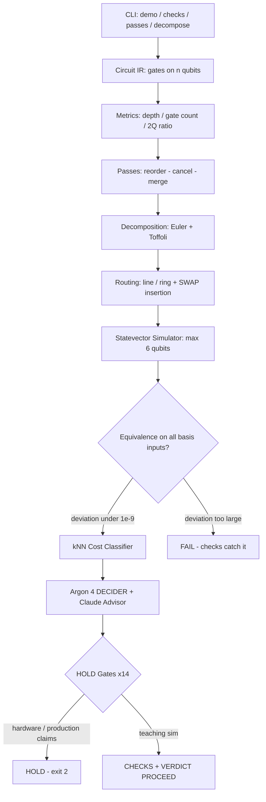
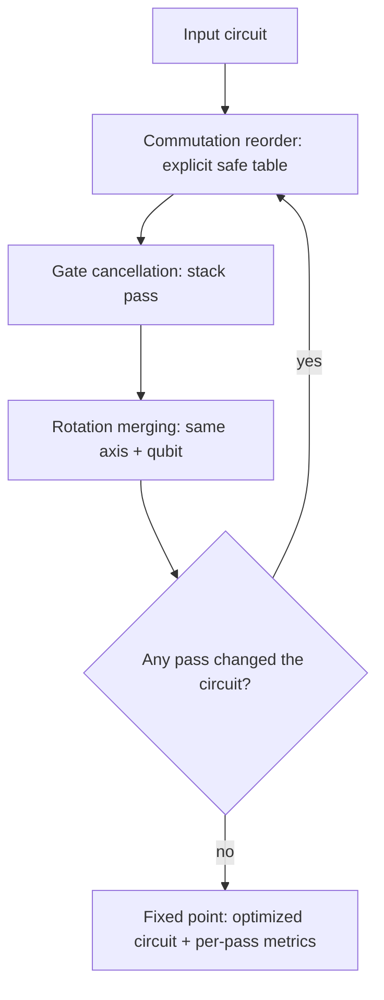
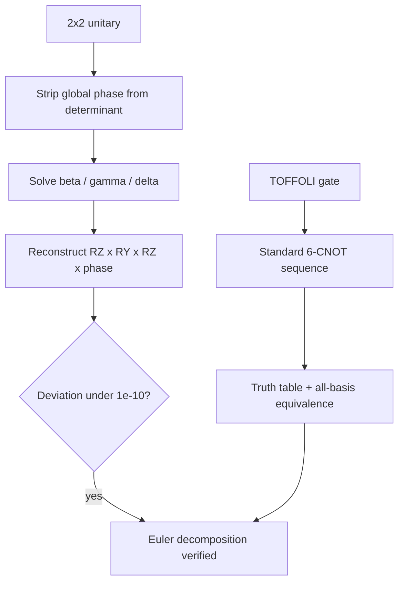
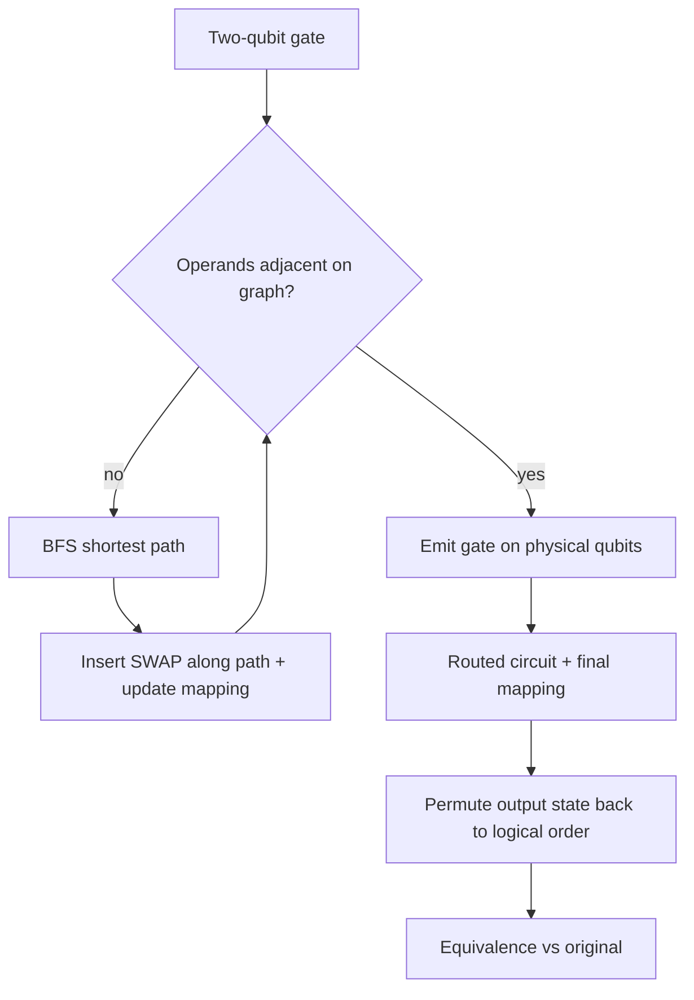
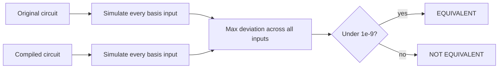
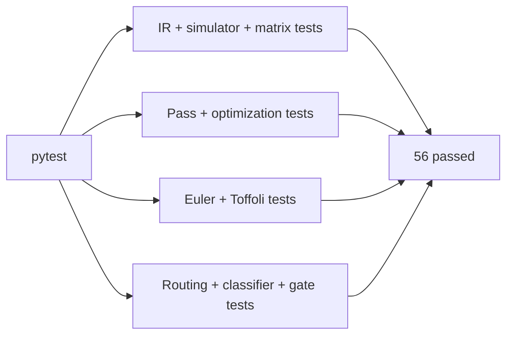
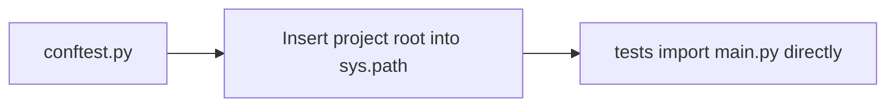
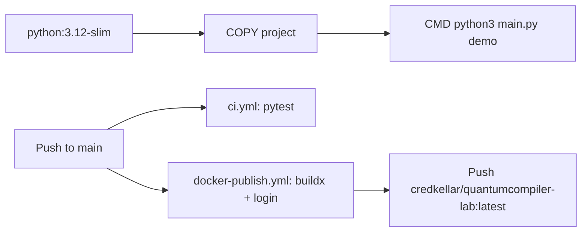

# QuantumCompiler-Lab 🧮⚛️

**Quantum Circuit Compiler / Transpiler Lab** — by Darion Kellar

QuantumCompiler-Lab is an **educational quantum circuit compiler** in ONE pure-Python file. It defines a tiny circuit IR, runs **conservative compiler passes written from scratch** (gate cancellation, rotation merging, commutation-based reordering), **decomposes** gates (any 2×2 unitary into RZ–RY–RZ Euler form; Toffoli into the standard 6-CNOT form), **routes** circuits onto line and ring coupling graphs with SWAP insertion, reports **before/after metrics for every pass** — and then **proves the optimized circuit is the same computation** with an exact statevector simulator run over **every basis input**.

The honest scope is the whole point, and it is stated everywhere:

- ✅ **What it is:** a teaching transpiler for toy circuits (≤ 6 qubits) whose every optimization is checked by simulation, with the numbers printed.
- 🚫 **What it is not:** Qiskit, a production transpiler, or a hardware compiler. It targets **no device**, submits **nothing**, and models **no calibration, crosstalk, or noise**. Simulated equivalence is exact for these toy circuits — it is not a hardware fidelity claim.

Every real-hardware / production / advantage claim sits behind a permanent HOLD gate (14 total). 🔒

[](https://github.com/kimanicollier44-cmyk/QuantumCompiler-Lab/actions/workflows/ci.yml)
[](https://github.com/kimanicollier44-cmyk/QuantumCompiler-Lab/actions/workflows/docker-publish.yml)

> ℹ️ These are the **live** workflow badges for this repo. They activate as soon as the `ci.yml` and `docker-publish.yml` files from the paste pack are pasted into `.github/workflows/` — until then they have nothing to report yet.

## 🧰 Tech Stack Badges & Full Architecture Tech Stack

### 💻 Core Programming Languages & Core Systems


- 🐍 Python 3.12, pure standard library (`cmath`, `hashlib`, `json`, `math`, `sys`, `collections`) — zero dependencies, zero network, deterministic (double-run byte-identical)
- 🧮 Complex matrix algebra implemented by hand: multiplication, dagger, embedding of local gates into the full 2ⁿ space — no NumPy, so every number can be read and checked
- 🛠️ Compiler passes from scratch: stack-based cancellation, rotation merging, and a commutation pass driven by an explicit, conservative safe-swap table
- 🗺️ Routing: BFS shortest paths on line/ring coupling graphs, SWAP insertion with a tracked logical→physical mapping
- 🧠 TinyML kNN circuit-cost classifier (from scratch, stdlib): cheap / moderate / expensive from (depth, 2Q ratio, SWAP overhead), labels generated by the lab's own cost model
- 🪑 Council seats: Gemini Argon 4 DECIDER (names-only, tighten-only) + Muse advisor (never overrides HOLD) + Google Flow plan-only (rendered = False, live = 0)

### ⛓️ Web3 & Infrastructure

- 🚫 **Not applicable — honestly.** No blockchain, no Web3, no tokens: this is an offline compiler lab in one Python file. No fake badges here.

### ⚙️ Platform Support & Hardware Architecture


- 🖥️ Pure Python — runs anywhere Python 3.12+ runs (Linux, macOS, Windows), plus the `python:3.12-slim` Docker image
- 🔒 No quantum hardware is targeted or controlled, ever: real-device compilation is a permanent HOLD gate (see the gate table below)

### ⚡ Low-Level Infrastructure & Performance

- 🚫 **No low-level code — honestly.** No C, no C++, no GPU, no compiled extensions: one interpreted Python file on purpose, so every pass, matrix, and metric can be read, checked, and diffed. Performance here means honest algorithms — stack cancellation, fixed-point pass iteration, BFS routing — all deterministic and byte-identical between runs.

### 🛠️ DevOps & Build Tools


- 🐳 Docker (`python:3.12-slim`), GitHub Actions CI + Docker Publish (delivered in the paste pack)
- 🎯 Target image: `credkellar/quantumcompiler-lab:latest`
- 🧪 Tests: `pytest` (56 tests) + the built-in CHECKS suite (55 checks) in `main.py`

### ☁️ Cloud Providers

- 🚫 **None — honestly.** No cloud provider is used or needed: the lab runs fully offline on your own machine or in a local Docker container. Docker Hub appears only as the registry the publish workflow pushes the image to.

## What this does?

1. 🧱 **Circuit IR** — a circuit is a list of JSON-friendly gates (H, X, Y, Z, S, SDG, T, TDG, RX/RY/RZ with angles, CNOT, CZ, SWAP, TOFFOLI) on n qubits. Qubit 0 is the least-significant basis bit; the convention is stated once and used everywhere, simulator included.
2. 📏 **Metrics before opinions** — every circuit is measured the same way: gate count, depth (greedy per-qubit layer scheduling), multi-qubit count, SWAP count, 2Q ratio. Each pass reports the metrics it changed, so "optimized" is a table, not an adjective.
3. ✂️ **Gate cancellation** — adjacent identical self-inverse pairs (H·H, X·X, CNOT·CNOT, …) are removed by a stack pass: removing one pair can expose the next pair, which then cancels in the same run.
4. 🔄 **Rotation merging** — adjacent rotations around the same axis and qubit combine (RZ 0.2 + RZ 0.7 → RZ 0.9, normalized to (−π, π]); exact opposites cancel to nothing.
5. ↔️ **Commutation reordering (lite, provably safe)** — gates may swap only under an explicit table: disjoint qubits; Z-family through a CNOT **control**; X-family through a CNOT **target**; Z-family through CZ; same-family rotations on one qubit. A swap is made only when it brings a cancellable or mergeable pair together — and the table's refusals (X on a control, Z on a target) are asserted in the checks.
6. 🎯 **The demo, graded** — the demo circuit enters with **12 gates, depth 7, 2Q count 3** and leaves with **3 gates, depth 2, 2Q count 1**: the H pair cancels, a Z commutes through the CNOT control to meet and cancel its twin, the rotations merge, the X pair and the CNOT pair cancel.
7. 🧭 **Euler decomposition** — any 2×2 unitary (validated unitary first) decomposes to a global phase × RZ(β)·RY(γ)·RZ(δ), with the reconstruction deviation asserted (sample: **2.8e-16**). The branch that solves for β/δ is documented where a naive modulo would silently flip a sign.
8. 🔓 **Toffoli decomposition** — the standard exact 6-CNOT form with T/TDG/H dressing, checked two independent ways: against the Toffoli truth table (basis 3 ↔ 7 with both controls set) and by full equivalence on all 8 basis inputs (deviation **3.1e-16**).
9. 🗺️ **Mapping + routing** — on a line graph, a CNOT between qubits 0 and 3 costs **2 inserted SWAPs** and the logical→physical mapping moves with them; on a ring the same gate is already adjacent and costs **0**. Routed circuits are proven equivalent *after* the final mapping is applied to the output state — the step real routing write-ups often skip.
10. ✅ **Equivalence as the referee** — an exact statevector simulator (≤ 6 qubits, hand-written complex matrices) runs original and compiled circuits on **every basis input** and reports the max deviation (demo: **2.0e-16**, tolerance 1e-9). A cheaper circuit that computes something else is a failure, and the checks would catch it.

## 🗺️ How it works — diagram per script

### `main.py` — the whole lab



### `main.py` § passes — fixed-point optimization



### `main.py` § decomposition — Euler and Toffoli



### `main.py` § routing — SWAPs on a coupling graph



### `main.py` § equivalence — the referee



### `tests/test_main.py` — verification



### `conftest.py` — test path setup



### `Dockerfile` + CI flow — container & publish



## Why is this cool?

1. ✂️ The optimizer's wins are **arithmetic, not adjectives**: 12 → 3 gates, depth 7 → 2, 2Q 3 → 1, printed per pass.
2. ↔️ The commutation table is **honest about its refusals**: Z slides through a CNOT control, X through a target — and the two moves that would be wrong are named and tested as non-commuting.
3. 🧭 The Euler solver documents its own trap: reduce the angle difference modulo 2π too early and the reconstruction flips a sign — the lab shows the branch that doesn't.
4. 🔓 Toffoli is verified **twice**: truth table and full equivalence, so a sequence that merely looks standard has to actually compute Toffoli.
5. 🗺️ Routing keeps the receipt: the final logical→physical mapping is returned and *used* in the equivalence check, instead of pretending SWAPs are free.
6. 🎯 Equivalence is **exhaustive at this scale**: every basis input, not a few random test vectors — at ≤ 6 qubits there is nowhere for a wrong pass to hide.
7. 🧮 The linear algebra is **hand-written**: no NumPy black box — embedding a gate into 2ⁿ space is forty lines you can audit.
8. 🔁 The pass loop runs to a **fixed point**: reorder can expose a cancellation, cancellation can expose a merge, and the loop only stops when nothing changes.
9. 🏷️ The classifier's labels come from the **metrics model itself** — the kNN interpolates the lab's stated cost rules instead of inventing a second standard.
10. 🎯 Deterministic end to end: run it twice, get byte-identical output — a compiler you can diff.

## What problems this solves?

1. ❌ **Problem:** "Optimized" quantum circuits whose output quietly changed. ✅ **Solution:** Every optimization claim is paired with an all-basis equivalence report and a max deviation; a cheaper-but-different circuit fails the checks.
2. ❌ **Problem:** Transpiler tutorials that show passes but never measure them. ✅ **Solution:** Per-pass metrics (gates, depth, 2Q) are printed for the demo circuit, so each pass has to earn its place.
3. ❌ **Problem:** Commutation rules waved through as "these basically commute". ✅ **Solution:** An explicit safe-swap table with the unsafe cases (X on a control, Z on a target) asserted as refusals in code.
4. ❌ **Problem:** Euler decomposition presented as a formula to copy, sign errors included. ✅ **Solution:** The solver reconstructs the matrix and asserts the deviation, including identity, H, X, and T edge cases.
5. ❌ **Problem:** Toffoli decompositions copied from diagrams that may not match the qubit convention. ✅ **Solution:** The sequence is verified against the truth table under this lab's stated bit convention, and by full equivalence.
6. ❌ **Problem:** Routing explanations that count SWAPs but forget the mapping moved. ✅ **Solution:** The router returns the final mapping and the equivalence check permutes the output back through it.
7. ❌ **Problem:** "2Q count" left vague — does a Toffoli count? ✅ **Solution:** The metrics print both the multi-qubit cost count (Toffoli included) and the strict two-qubit count, labelled.
8. ❌ **Problem:** Compiler demos that need a framework install before the first run. ✅ **Solution:** One stdlib-only Python file; `python3 main.py` runs the demo and all 55 checks offline.
9. ❌ **Problem:** Toy compilers marketed as hardware-ready. ✅ **Solution:** 14 named HOLD gates keep every hardware, production, fidelity, and advantage claim at exit code 2, permanently.
10. ❌ **Problem:** Students told to trust that a pass is "obviously safe". ✅ **Solution:** Nothing here is trusted — cancellation, merging, reordering, decomposition, and routing each carry a simulation-backed check with the deviation printed.

## How to install this?

1. 📋 Clone or download this project folder:

```bash
git clone https://github.com/kimanicollier44-cmyk/QuantumCompiler-Lab.git
```

2. 🐍 Make sure Python 3.12+ is installed: `python3 --version`
3. ▶️ Run the full demo + checks (no arguments needed):

```bash
python3 main.py
```

4. 🧪 Run the test suite:

```bash
pip install pytest
python3 -m pytest -q
```

5. 🎛️ Try the other commands:

```bash
python3 main.py checks    # 55 built-in checks
python3 main.py passes    # per-pass metrics on the demo circuit
python3 main.py decompose # Euler decomposition + Toffoli unfolding
python3 main.py route     # line vs ring routing, SWAP counts, mappings
python3 main.py equiv     # equivalence bundle: optimized + Toffoli + routed
python3 main.py classify  # kNN circuit-cost classifier report
python3 main.py brains    # Argon 4 + Muse + Flow seats
python3 main.py holds     # list all 14 HOLD gates
python3 main.py hold-demo # exits 2 - gated actions stay HOLD
```

6. 🐳 Or run it in Docker:

```bash
docker pull credkellar/quantumcompiler-lab:latest
docker run --rm credkellar/quantumcompiler-lab:latest
```

## Requirements

- 🐍 Python 3.12 or newer
- 📦 Dependencies: **none** (standard library only)
- 🌐 Network: **none** — fully offline
- 🧪 For tests only: `pytest`
- 🐳 Optional: Docker

## FULL project structure tree

```text
quantumcompiler-lab/
├── main.py                  # the whole lab: circuit IR, matrices, simulator, passes, Euler + Toffoli decomposition, routing, metrics, classifier, seats, HOLD gates
├── conftest.py              # puts the project root on sys.path for tests
├── tests/
│   └── test_main.py         # 56 pytest tests: IR, simulator, passes, decomposition, routing, equivalence, classifier, gates, seats
├── assets/
│   └── cover.png            # README cover image (2736 x 912)
├── .github/
│   └── workflows/
│       ├── ci.yml           # paste-in from the workflow pack
│       └── docker-publish.yml # paste-in from the workflow pack (tag: credkellar/quantumcompiler-lab:latest)
├── Dockerfile               # python:3.12-slim, runs the demo
├── .gitignore               # __pycache__/, .pytest_cache/, *.pyc
└── README.md                # this file
```

> 📦 Delivered separately as paste packs (not in this tree): `.github/workflows/ci.yml` + `docker-publish.yml`, and the Docker Hub pack (100-char description, 350-char About, overview, categories).

## 🔒 HOLD gates — all 14, permanent

| # | Gate | What stays held |
|---|------|-----------------|
| 1 | `real_hardware_compilation_claim` | No claim that this teaching transpiler compiles for real quantum hardware |
| 2 | `production_transpiler_claim` | No production transpiler, enterprise compiler, or drop-in Qiskit replacement claim |
| 3 | `quantum_advantage_claim` | No quantum advantage, speedup, or supremacy claim from toy-circuit metrics |
| 4 | `hardware_native_gate_claim` | No claim that emitted gates are native, calibrated, or executable on a named device |
| 5 | `error_correction_guarantee_claim` | No fault-tolerance or error-correction guarantee from decomposition or routing examples |
| 6 | `fidelity_guarantee_claim` | No hardware fidelity, coherence, or error-rate guarantee; simulated equivalence is not device fidelity |
| 7 | `commercial_compiler_claim` | No commercial compiler, optimization service, or customer workload claim |
| 8 | `cloud_hardware_submission` | No submitting circuits to cloud quantum hardware or a live provider account |
| 9 | `proprietary_backend_claim` | No reverse-engineered, proprietary, or vendor-confidential backend targeting claim |
| 10 | `real_device_calibration_claim` | No real-device calibration, pulse, crosstalk, or timing model is present or implied |
| 11 | `cryptographic_security_claim` | No claim that a compiled toy circuit establishes cryptographic security |
| 12 | `medical_scientific_decision_claim` | No using this lab as the basis for medical, engineering, or scientific decisions |
| 13 | `financial_decision_claim` | No financial, trading, procurement, or investment decision claim from compiler metrics |
| 14 | `replace_expert_review_claim` | No replacing compiler, physics, hardware, or safety review by qualified experts |

🧑‍⚖️ **Council seats:** Gemini Argon 4 Extended Thinking — DECIDER (names-only, tighten-only, MAP → MODEL → STRESS → DECIDE, sha256 trace, `can_override_hold = False`) · Muse — advisor (`can_override_hold = False`) · Google Flow — plan-only (`rendered = False`, `live = 0`).

✅ **Verification:** pytest **56 passed** (project + clean copy) · built-in CHECKS **55/55** · double-run output **byte-identical** · `hold-demo` exits **2** · `main.py` **1,255 lines**, pure stdlib, zero network.

## 🧒 5th-grade English section

Imagine you wrote instructions for a robot, but the instructions are messy: "clap, clap, turn a little, turn a little more, wave, wave." 🤖

- **This lab is a tidy-up machine for quantum instructions.** If the same move appears twice in a row and cancels itself out (like clapping twice when two claps undo each other), it deletes both. If two little turns can be added into one bigger turn, it adds them. 🧹
- Sometimes two moves are stuck apart with a friendly move between them that doesn't mind being swapped — the lab carefully swaps them so the cancelling pair can meet. It only swaps moves on its **safe list**, never by guessing. ↔️
- Big moves get **unfolded** into smaller standard moves, like turning "do a triple jump" into the exact hops that make it up — and then the lab *tests* that the unfolded version really does the same thing. 🔓
- The qubits (the robot's hands) might not all be able to reach each other, so sometimes the lab adds **swap moves** to pass things along a line — and it counts every swap it adds. 🗺️
- Best part: after all the tidying, the lab makes the original and the tidy version **race on every possible starting position** and checks they finish in exactly the same place. If they don't, the tidy-up failed — and the lab says so. 🏁

---

MIT © 2026 Darion Kellar · QuantumCompiler-Lab — educational simulation only 🧮
